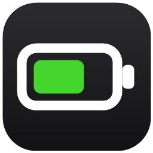

# Battery Level



Battery Level es una app chiquita para Windows 10 y 11. Muestra en la barra de tareas, al lado de la bandeja, cuánta batería les queda a tus dispositivos.

- **Dispositivos Razer** (mouse, auriculares, teclados inalámbricos): con Razer Synapse abierto, el dato sale de lo que Synapse va anotando. Sin Synapse, se lo pide directo al dongle o al cable (por ahora solo el Basilisk V3 Pro 35K).
- **Cualquier dispositivo Bluetooth conectado que informe su batería a Windows**: auriculares, parlantes, joysticks, mouse, teclados.
- **Joysticks Xbox y compatibles por el adaptador de Xbox o por USB**: Windows da solo 4 niveles (vacía, baja, media, llena), así que el % es aproximado. Por Bluetooth, el joystick de Xbox da el % exacto.

Cuando conectás un dispositivo con batería, aparece solo a los pocos segundos.

## Cómo se ve

Cada dispositivo muestra su logo (el de Razer, auriculares, parlante o joystick), una batería dibujada y el porcentaje.

- La batería es blanca o negra según el tema de Windows.
- Se pone amarilla al 30% o menos y roja al 15% o menos, con aviso.
- Cuando carga, se pone verde, late y muestra un rayo.
- Con clic izquierdo se abre una ventanita con el detalle de todos los dispositivos.
- Con clic derecho elegís qué dispositivos se ven en la barra. Los que saques ahí siguen apareciendo en los íconos ocultos (`^`), donde están todos siempre.
- El panel se oculta con juegos o videos a pantalla completa.

## Instalar

1. Bajá `BatteryLevel-Setup.exe` de la sección [Releases](../../releases).
2. Abrilo y tocá **Instalar**. Se instala solo para tu usuario y no pide permisos de administrador.

> [!WARNING]
> **Es normal que Windows avise "Windows protegió tu PC" (SmartScreen).**
> Pasa con casi todos los programas nuevos de estudios chicos. Windows muestra ese aviso hasta que muchas personas bajan el programa, o cuando su firma no la emitió una autoridad comercial paga, como en este caso: el certificado es propio de Ctrl + Save Design Studio. No quiere decir que tenga un virus.
>
> Para seguir, tocá **Más información** y después **Ejecutar de todas formas**. Ahí va a decir "Editor desconocido": es esperable con un certificado propio.
>
> **Cómo saber que es la copia original:**
> - Bajalo solo desde [Releases](../../releases) de este repositorio.
> - Clic derecho en el archivo > *Propiedades* > *Firmas digitales*: tiene que decir **Ctrl + Save Design Studio**.
> - El programa revisa su propia firma al abrirse. Si alguien lo modificó, muestra un aviso rojo y no se abre.

Para desinstalar: *Configuración > Aplicaciones > Aplicaciones instaladas > Battery Level > Desinstalar*.

El instalador también acepta estas opciones: `/silencioso`, `/sin-inicio` y `/sin-abrir`.

## Firma digital y copias modificadas

`BatteryLevel.exe` y `BatteryLevel-Setup.exe` están firmados digitalmente por **Ctrl + Save Design Studio**. Cada vez que se abren, revisan su propia firma. Si alguien los modificó, les sacó la firma o los firmó con otro certificado, muestran un aviso y no se abren. El instalador también revisa el programa que trae adentro antes de instalarlo.

- Huella del certificado: `56BDEEC1FB847B3C2A684D7D0E3F7FB26E620A6C` (el certificado público está en `CtrlSave-Design-Studio.cer`).
- Para revisarlo a mano: clic derecho en el .exe > *Propiedades* > *Firmas digitales*.
- Los hashes SHA-256 de cada versión están en `SHA256SUMS.txt`, en Releases.

El certificado es propio, no lo emitió una autoridad comercial. Por eso Windows lo muestra como "no confiable" o "editor desconocido". Igual sirve para detectar cualquier cambio en el archivo.

**Ctrl + Save Design Studio no se hace cargo de copias modificadas** ni de lo que puedan hacer. Bajá el instalador solo de este repositorio o pedíselo directamente al estudio.

## Compilar

```powershell
powershell -ExecutionPolicy Bypass -File .\build.ps1
```

Usa el `csc` de .NET Framework 4 que ya trae Windows, así que no hace falta instalar nada. El resultado queda en `dist\`: `BatteryLevel.exe`, `BatteryLevel-Setup.exe` (que lleva la app adentro) y `SHA256SUMS.txt`. Para firmar hace falta el certificado de Ctrl + Save Design Studio con su clave privada, que está solo en la PC del estudio. Sin él, la compilación se corta.

`BatteryLevel.exe --prueba` escribe lo que lee en `prueba.txt`.

## ¿Te sirvió? Invitame un café

Battery Level es gratis. Si te gustó y querés apoyar a Ctrl + Save Design Studio para que siga haciendo programas así:

- Desde Argentina, en pesos con Mercado Pago: [cafecito.app/controlsave](https://cafecito.app/controlsave)
- Desde cualquier país, en dólares con PayPal: [ko-fi.com/controlsave](https://ko-fi.com/controlsave)

También está en la app: clic derecho > *Donar a Ctrl + Save Design Studio*.

## Aviso

Razer y Razer Synapse son marcas de Razer Inc. Este proyecto no está afiliado a Razer. La app no incluye el logo de Razer: lo toma, si existe, del Razer Synapse instalado en la PC.

---

Proyecto elaborado por Ctrl + Save Design Studio

Copyright (c) 2026 Ctrl + Save Design Studio. Todos los derechos reservados.
